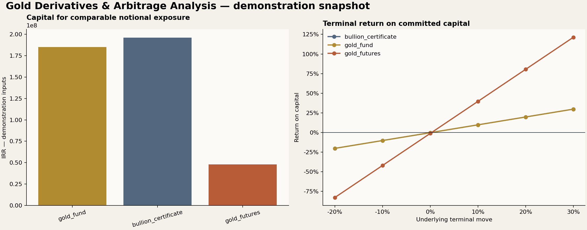

# Gold Derivatives & Arbitrage Analysis

A Python reconstruction of a personal research workbook for comparing Iranian gold funds, bullion deposit certificates and futures contracts.

The project converts contract specifications and market quotes into comparable capital requirements, basis measures and scenario returns. It is designed to make assumptions explicit and auditable rather than to label a quote as a guaranteed arbitrage.

> **Research only:** This project has not been used for live trading. It is not investment advice and does not claim executable or risk-free profit.



## Questions addressed

- How much cash or margin is required for each instrument?
- What is the futures premium or discount to the selected spot proxy?
- What is the simple and annualized basis to maturity?
- How does futures leverage change gains and losses relative to funded exposure?
- Does a cash-and-carry spread remain positive after explicit costs?
- How sensitive are outcomes to the terminal gold scenario?

## Quick start

```bash
python3 -m venv .venv
source .venv/bin/activate
python3 -m pip install -r requirements.txt
python3 run_analysis.py
```

The command uses clearly labeled demonstration quotes and writes a chart and CSV tables to `outputs/`.

## Custom market inputs

Create a JSON file:

```json
{
  "fund_price": 185000,
  "fund_nav": 181500,
  "certificate_price": 73500000,
  "certificate_units_per_gram": 1000,
  "futures_price": 196000,
  "contract_multiplier": 1000,
  "initial_margin": 48000000,
  "days_to_maturity": 76,
  "round_trip_cost_rate": 0.003,
  "annual_funding_rate": 0.30
}
```

Then run:

```bash
python3 run_analysis.py --input market.json
```

Prices and contract multipliers must use internally consistent units. Exchange specifications can change; verify the current contract notice before interpreting any output.

## Core calculations

- Fund premium: `fund price / NAV - 1`
- Futures basis: `futures price / spot proxy - 1`
- Annualized basis: `(1 + basis) ** (365 / days) - 1`
- Notional exposure: `futures price × contract multiplier`
- Margin leverage: `notional exposure / initial margin`
- Cash-and-carry net spread: futures proceeds less funded spot cost and explicit transaction costs

The terminal scenario engine marks both funded instruments and futures to the same percentage move. Futures P&L is divided by posted margin; this makes downside outcomes larger as well as upside outcomes.

## Data source and licensing

No proprietary or ambiguously licensed historical dataset is distributed. The default input is a synthetic market snapshot included only to demonstrate the calculations. For real research, users should enter authorized quotes and cite the Iran Mercantile Exchange contract specification, the relevant fund disclosure/NAV source and the applicable exchange market feed.

## Important limitations

- A positive theoretical spread is not proof that both legs can be executed.
- Daily settlement and margin calls can force an early exit.
- Position limits, price limits, liquidity and bid–ask spreads are not inferred from closing prices.
- Certificate delivery, storage, conversion and redemption rules may add costs or delays.
- Fund tracking error and NAV publication timing can distort direct comparisons.
- Tax, brokerage fees and funding availability are user inputs, not universal constants.
- Contract multipliers and quote units must be verified for each symbol and expiry.

## Project structure

```text
gold_derivatives/
  models.py       # validated market specification
  analytics.py    # basis, capital and arbitrage calculations
  scenarios.py    # terminal-price scenario engine
  report.py       # tables and chart
tests/
run_analysis.py
```

## Author

**Shabar Naderi** — Financial Data Analyst focused on Python, quantitative research and Iranian financial markets.

- [GitHub](https://github.com/shna1)
- [LinkedIn](https://www.linkedin.com/in/shabar-naderi-1b7623b2/)
